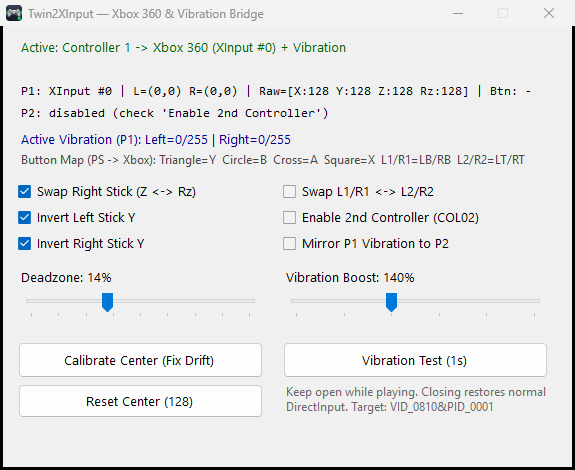

# Twin2XInput (Azərbaycan dili)

[Read in English (README.md)](README.md)

Windows-da ucuz **Twin USB Joystick** (`VID_0810&PID_0001`) və oxşar DualShock tipli USB HID oyun pultlarını **tam Xbox 360 (XInput) + ikili vibrasiya** ilə işlədən yüngül proqram.

Əgər pultunuz köhnə oyunlarda işləyir, amma müasir XInput oyunlarında tanınmır, `x360ce` quraşdırmaqda çətinlik çəkirsinizsə və ya **vibrasiya ümumiyyətlə işləmirsə**, Twin2XInput həm düymə/stikləri, həm də sağ-sol motor vibrasiyasını **ViGEmBus** vasitəsilə problemsiz ötürür.



---

## Tələblər (Mütləqdir)

`Twin2XInput.exe` proqramını işlətməzdən əvvəl pulsuz **ViGEmBus** driverini bir dəfə quraşdırın:

1. Rəsmi [ViGEmBus Releases](https://github.com/nefarius/ViGEmBus/releases) səhifəsindən **`ViGEmBusSetup_x64.msi`** faylını yükləyin.
2. Quraşdırmanı tamamlayın (Windows 10/11 64-bit).

> Driver quraşdırılmayıbsa, proqram açıldıqda qırmızı xəbərdarlıq və birbaşa yükləmə linki göstərəcək.

---

## İstifadə Qaydası

1. **Releases** bölməsindən ən son `Twin2XInput-*-win64.zip` arxivini yükləyin və bütün faylları bir qovluğa çıxarın (`Twin2XInput.exe` və `vigemclient.dll` yan-yana olmalıdır).
2. USB pultu kompüterə qoşun (analoq stiklərin işləməsi üçün pultun üzərindəki **ANALOG** düyməsini aktiv edin).
3. **`Twin2XInput.exe`** faylını açın.
4. Oyun oynadığınız müddətdə pəncərəni açıq saxlayın. Proqramı bağladıqda pultlar dərhal normal DirectInput rejiminə qayıdır (oyun fayllarına heç nə yazılmır).

---

## Seçimlər və İdarəetmə

| Seçim | İzahı |
| --- | --- |
| **Swap Right Stick (`Z <-> Rz`)** | Twin USB pultlarda sağ stikin X/Y oxlarının qarışmasını düzəldir. |
| **Invert Left / Right Stick Y** | Sol və sağ stikin yuxarı-aşağı istiqamətini standart Xbox 360 yönünə çevirir. |
| **Swap `L1/R1 <-> L2/R2`** | L1/R1 və L2/R2 düymələrinin yerini dəyişir. |
| **Enable 2nd Controller (`COL02`)** | İkili adapterin 2-ci pultunu da `XInput #1` kimi qoşur (öz vibrasiyası ilə). |
| **Mirror P1 Vibration to P2** | 1-ci pultun vibrasiyasını 2-ci pulta da ötürür (tək nəfərlik oyunlarda 2-ci pultdan istifadə edərkən faydalıdır). |
| **Deadzone (`0%–40%`)** | Stiklərdəki xırda boşluq (drift) hərəkətini aradan qaldırır. |
| **Vibration Boost (`100%–200%`)** | Zəif və orta vibrasiya siqnallarını gücləndirir (aparat maksimumu `255`-dir). |
| **Calibrate Center (Fix Drift)** | Stiklərin cari dayanma vəziyyətini mərkəz kimi yadda saxlayır. |
| **Vibration Test (`1s`)** | Sol və sağ motoru 1 saniyə yoxlayır. |

### Düymə Uyğunluğu (`PS -> Xbox`)

- **Üçbucaq / Dairə / X / Kvadrat** → `Y / B / A / X`
- **L1 / R1** → `LB / RB`
- **L2 / R2** → `LT / RT`
- **Select / Start** → `Back / Start`
- **L3 / R3** → Sol / Sağ stik basışı

---

## Başqa Pultlar üçün `VID` / `PID` Ayarı

Standart olaraq `VID_0810&PID_0001` axtarılır. Proqram bir dəfə açıldıqda yanında `twin2xinput.ini` faylı yaranır. Oxşar USB pultları test etmək üçün Device Manager-dən `VID` və `PID` kodlarını götürüb dəyişə bilərsiniz:

```ini
TargetVid=0810
TargetPid=0001
```

---

## Müstəqil Vibrasiya Test Skripti

Driver olmadan pultun motorlarını birbaşa HID paketləri ilə yoxlamaq üçün [scripts/VibrationTester.ps1](scripts/VibrationTester.ps1) skriptindən istifadə edə bilərsiniz:

```powershell
powershell -ExecutionPolicy Bypass -File .\scripts\VibrationTester.ps1
```

---

## Mənbə Kodundan Yığma (Build)

Əlavə Visual Studio lazım deyil — Windows-un daxili `csc.exe` kompilyatoru kifayətdir:

```bat
build.bat
```

Hazır fayllar `dist\` qovluğunda yaranır.

---

## Lisenziya və Müəlliflik

- Layihə [MIT Lisenziyası](LICENSE) ilə paylaşılır.
- [ViGEmClient](https://github.com/nefarius/ViGEmClient) (`vigemclient.dll`, MIT) kitabxanasından istifadə edir və **Nefarius Software Solutions e.U.** tərəfindən yaradılmış [ViGEmBus](https://github.com/nefarius/ViGEmBus) driverini tələb edir — bax: [THIRD_PARTY_NOTICES.md](THIRD_PARTY_NOTICES.md).

