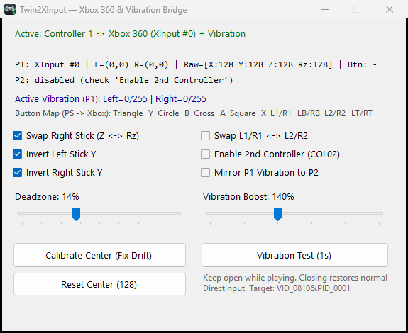

# Twin2XInput

[Azərbaycan dilində oxu (README.az.md)](README.az.md)

Lightweight **Xbox 360 (XInput) + Dual-Motor Vibration** bridge for affordable **Twin USB Joystick** (`VID_0810&PID_0001`) and compatible DualShock-style USB HID gamepads on Windows.

If your budget USB controller works in older DirectInput games but fails in XInput games, struggles with `x360ce`, or **never vibrates**, Twin2XInput bridges both sticks, buttons, triggers, and hardware rumble cleanly using **ViGEmBus**.



---

## Prerequisites (Required)

Before running `Twin2XInput.exe`, install the free **ViGEmBus** kernel driver once:

1. Download **`ViGEmBusSetup_x64.msi`** (or the latest installer) from the official [ViGEmBus Releases](https://github.com/nefarius/ViGEmBus/releases) page.
2. Run the installer and finish setup (Windows 10/11 64-bit).

> If ViGEmBus is not installed, Twin2XInput will display a red warning with a clickable download link.

---

## Quick Start

1. Download the latest `Twin2XInput-*-win64.zip` from **Releases** and extract all files into one folder (`Twin2XInput.exe` must stay next to `vigemclient.dll`).
2. Plug in your USB controller(s). Press the **ANALOG** button on your controller if its analog sticks are not active.
3. Run **`Twin2XInput.exe`**.
4. Keep the window open while playing XInput games. Close it anytime to restore normal DirectInput behavior without changing any game files.

---

## Features & Controls

| Option | Description |
| --- | --- |
| **Swap Right Stick (`Z <-> Rz`)** | Fixes inverted/swapped right-stick X and Y axes common on Twin USB adapters. |
| **Invert Left / Right Stick Y** | Flips vertical stick polarity to match standard Xbox 360 orientation. |
| **Swap `L1/R1 <-> L2/R2`** | Swaps bumpers and triggers if you prefer PS-style trigger placement. |
| **Enable 2nd Controller (`COL02`)** | Exposes the second port of a dual adapter as `XInput #1` with independent vibration. |
| **Mirror P1 Vibration to P2** | Sends Player 1 rumble to both controllers (useful in single-player games when holding P2). |
| **Deadzone (`0%–40%`)** | Eliminates resting stick drift. |
| **Vibration Boost (`100%–200%`)** | Amplifies weak/medium rumble signals (capped at hardware max `255`). |
| **Calibrate Center (Fix Drift)** | Sets the current stick resting values as center. |
| **Vibration Test (`1s`)** | Pulses both left and right motors for 1 second to verify hardware rumble. |

### Button Mapping (`PS -> Xbox`)

- **Triangle / Circle / Cross / Square** → `Y / B / A / X`
- **L1 / R1** → `LB / RB`
- **L2 / R2** → `LT / RT`
- **Select / Start** → `Back / Start`
- **L3 / R3** → Left / Right Stick Click

---

## Custom `VID` / `PID` Configuration

By default, Twin2XInput targets `VID_0810&PID_0001`. After running the app once, a `twin2xinput.ini` file is created next to `Twin2XInput.exe`. You can edit `TargetVid` and `TargetPid` (4-character hex IDs from Device Manager → Hardware IDs) to test similar generic USB HID gamepads:

```ini
TargetVid=0810
TargetPid=0001
```

Leave `TargetPid=` empty to match any PID under `TargetVid`.

---

## Standalone HID Vibration Tester

The included [scripts/VibrationTester.ps1](scripts/VibrationTester.ps1) lets you test raw HID rumble motors directly without ViGEmBus:

```powershell
powershell -ExecutionPolicy Bypass -File .\scripts\VibrationTester.ps1
# Or target another USB Vendor/Product ID:
powershell -ExecutionPolicy Bypass -File .\scripts\VibrationTester.ps1 -Vid 0810 -Pid 0001
```

### Discovered `VID_0810&PID_0001` HID Rumble Protocol

Each port expects a **5-byte HID output report** (`OutLen = 5`, `ReportID = 1` for `COL01`, `ReportID = 2` for `COL02`):

| Byte | Purpose |
| --- | --- |
| `byte[0]` | `ReportId` (`0x01` or `0x02`) |
| `byte[1]` | `0x00` (unused) |
| `byte[2]` | `0x00` (unused) |
| `byte[3]` | **Left (Large) Motor** (`0x00–0xFF`) |
| `byte[4]` | **Right (Small) Motor** (`0x00–0xFF`) |

---

## Building from Source

No Visual Studio or extra .NET SDK is needed — Windows 10/11 includes the 64-bit `.NET Framework 4.x` compiler (`csc.exe`). Simply run:

```bat
build.bat
```

Output binaries are written to `dist\Twin2XInput.exe`.

---

## License & Credits

- Twin2XInput is licensed under the [MIT License](LICENSE).
- Uses [ViGEmClient](https://github.com/nefarius/ViGEmClient) (`vigemclient.dll`, MIT License) and requires [ViGEmBus](https://github.com/nefarius/ViGEmBus) by **Nefarius Software Solutions e.U.** — see [THIRD_PARTY_NOTICES.md](THIRD_PARTY_NOTICES.md).

